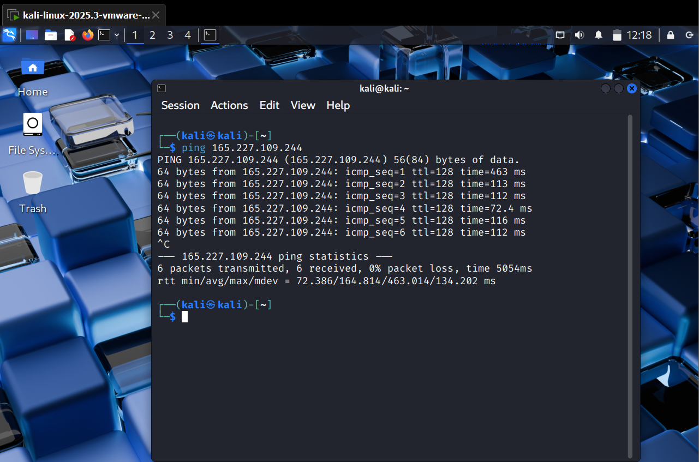
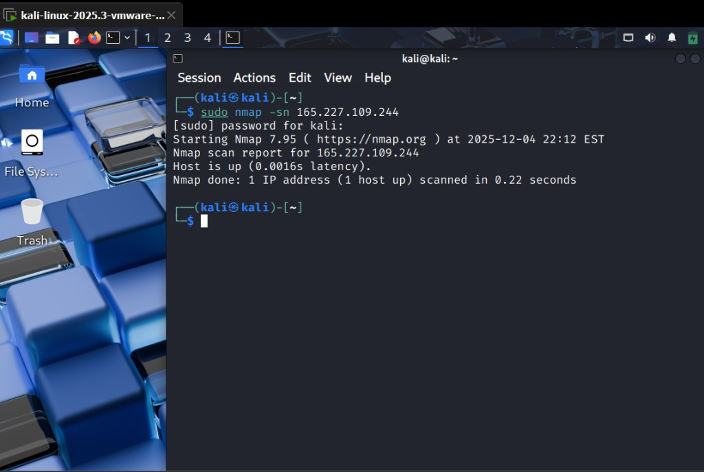
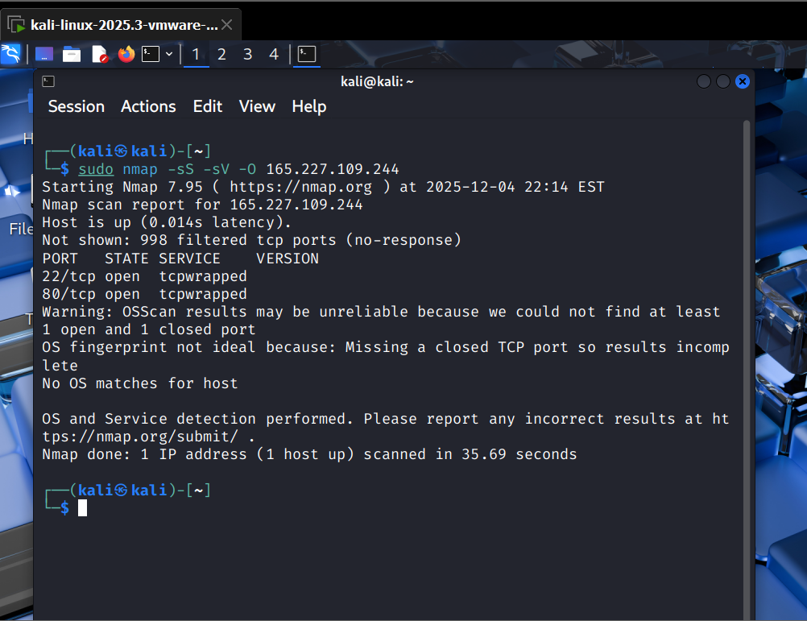
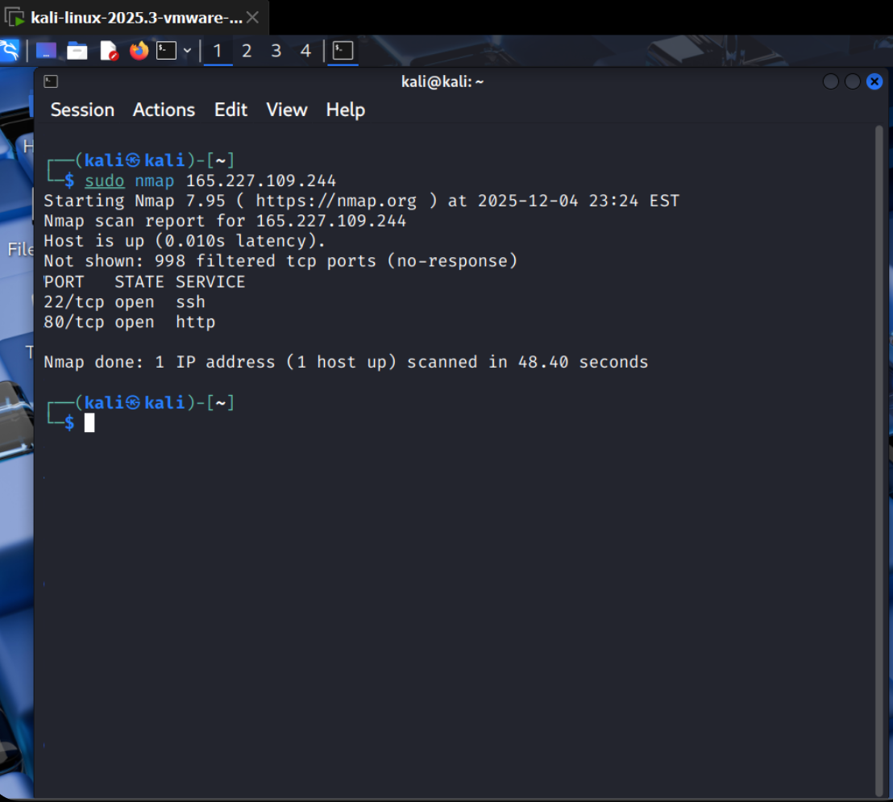
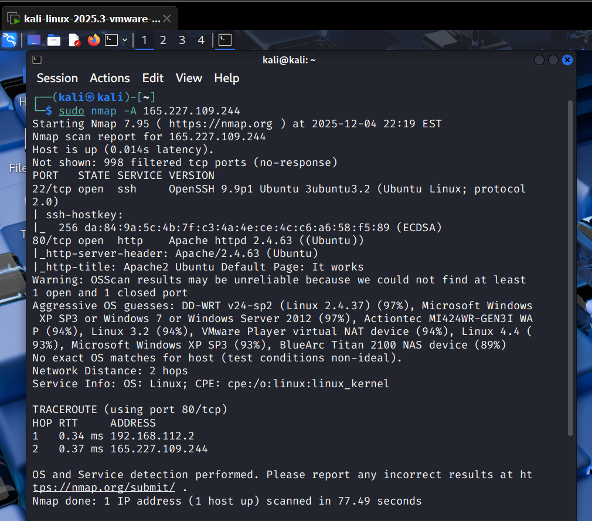

# Nmap Network Reconnaissance | Host Discovery & Service Enumeration

[](https://nmap.org/)
[](https://www.kali.org/)
[](https://nmap.org/book/man.html)
[](https://nmap.org/book/man-version-detection.html)

**Investigator:** Alexander Cox  
**Project type:** Individual, authorized reconnaissance exercise  
**Original lab:** *Penetration Testing Bandoo Enterprise — Lab 1*  
**Course:** Penetration Testing, Ethical Hacking and Network Defense  
**Institution:** Caribbean Maritime University  
**Lab date:** December 4, 2025

## Objective

Conduct an initial **active reconnaissance assessment** against a host supplied in the academic engagement scenario. Identify host availability, accessible TCP ports, service types, software versions, and any reliable clues about the operating system. The purpose was to create a technical baseline for a later vulnerability assessment, **not to exploit the system**.

The assignment described an IP range containing the target, but the evidence documents **scans of one IP address only**. It does not establish that the entire surrounding subnet was scanned.

### Skills demonstrated

- Active information gathering and ICMP reachability testing
- Nmap host discovery and TCP port-state interpretation
- TCP SYN scanning, service version detection, and OS fingerprinting attempts
- Comparing scan modes when results are incomplete
- Reading NSE script output, HTTP headers, and SSH banners
- Interpreting filtering, `tcpwrapped` results, and Nmap limitations
- Translating observations into practical defensive recommendations

## Tools & Assessment Scope

| Component | Details |
|---|---|
| Testing workstation | Kali Linux 2025.3 running as a virtual machine |
| Primary tool | Nmap 7.95 |
| Connectivity utility | `ping` (ICMP Echo Request) |
| Target host | `165.227.109.244` |
| Target described in assignment | `165.227.109.244/20` (subnet context) |
| Actual tested scope | **One host: `165.227.109.244`** |
| Testing type | Authorized active host and service reconnaissance |

> **Authorization:** The original assignment describes this system as supplied for a controlled ethical-hacking engagement. These commands should only be used against systems you own or have explicit authorization to assess. This README documents past lab results; it is not a request to rescan the public host.

## Lab workflow and logical path

```text
Kali Linux VM (Nmap 7.95)
         |
         |   ICMP Echo / TCP reconnaissance
         v
  192.168.112.2   (first traceroute hop observed)
         |
         v
Target: 165.227.109.244
    |-- 22/tcp   SSH   -> OpenSSH 9.9p1 (Ubuntu build)
    `-- 80/tcp   HTTP  -> Apache httpd 2.4.63 (Ubuntu)
```

*This is a simplified view of observed communication, not a verified physical network design. The intermediate address comes from the Nmap traceroute output.*

---

## Investigation methodology and evidence

### 1. Connectivity verification with `ping`

I first checked that the supplied host could be reached from Kali Linux before running deeper network discovery.

```bash
ping 165.227.109.244
```

**Command explanation**

- `ping` sends ICMP Echo Request packets and waits for Echo Reply packets.
- The IP address is the intended destination.
- On this Kali run, I stopped the command using `Ctrl+C` after collecting enough responses to inspect the statistics.

**Observed result:** The screenshot shows **6 packets transmitted, 6 received, and 0% packet loss**. The reported average round-trip time was approximately **164.8 ms**. This confirms ICMP reachability during that test, not that all services were accessible.



*Figure 1.1 — Kali Linux received replies from the assigned target.*

### 2. Host discovery with Nmap

Next, I verified target availability using Nmap's host-discovery mode, without performing a normal TCP port scan.

```bash
sudo nmap -sn 165.227.109.244
```

| Part | Meaning |
|---|---|
| `sudo` | Runs Nmap with elevated privileges so it can use privileged network operations where appropriate |
| `nmap` | Launches the network reconnaissance tool |
| `-sn` | Host discovery only; skips the normal port scan |
| `165.227.109.244` | The specific host checked |

**Observed result:** Nmap reported **“Host is up”** with approximately **0.0016 s** latency in this run. It scanned **one IP address and found one host up**.

> A single-host `-sn` scan is not a subnet-wide **ping sweep**. The submitted command checked only the supplied target address.



*Figure 1.2 — Nmap confirms that the target host responds to discovery probes.*

### 3. Combined SYN scan, version detection, and OS fingerprinting

After confirming reachability, I attempted to identify accessible TCP ports, software versions, and the target operating system in one scan.

```bash
sudo nmap -sS -sV -O 165.227.109.244
```

| Option | Meaning | Why I used it |
|---|---|---|
| `-sS` | TCP SYN scan | Determine which TCP ports respond as open, closed, or filtered without completing a normal application session for the port check |
| `-sV` | Service/version detection | Probe open ports to identify the software behind them |
| `-O` | OS fingerprinting | Compare network-stack responses to Nmap's OS fingerprint database |
| `sudo` | Elevated permissions | Enable privileged SYN/OS detection features |

**Observed result:**

- `22/tcp`: **open**, version probe labeled `tcpwrapped`.
- `80/tcp`: **open**, version probe labeled `tcpwrapped`.
- **998 TCP ports** were reported as **filtered (no response)**.
- OS detection warned that it could not find the usual combination of open and closed ports; the output explicitly stated **“No OS matches for host.”**

**Interpretation:** A filtered port commonly indicates that probes received no useful response, which can be caused by firewall policy or other network filtering. `tcpwrapped` means Nmap's version probes could not reliably identify the responding service, often because the connection closed early. **Neither result alone proves a specific firewall configuration, and this scan did not conclusively identify the OS.**



*Figure 1.3 — Open ports were found, but version and OS identification remained incomplete.*

### 4. Standard scan to confirm port states

Because the previous results were incomplete, I ran a simpler scan to check whether the accessible services could at least be classified by their default port assignments.

```bash
sudo nmap 165.227.109.244
```

**What this does:** Without additional scan-mode flags, Nmap performs its default discovery and common-port scan. On a privileged Unix-like host, its default TCP scan commonly uses SYN scanning. It does **not** enable detailed version detection unless requested.

**Observed result:**

| Port | State | Nmap service label |
|---|---|---|
| `22/tcp` | Open | `ssh` |
| `80/tcp` | Open | `http` |
| Other 998 scanned TCP ports | Filtered | No useful response |

This confirmed that two common services were exposed, but a port name is **not** proof of the exact application or version. Further service interrogation was needed.



*Figure 1.4 — The simpler scan identifies SSH and HTTP on ports 22 and 80.*

### 5. Aggressive Nmap scan for deeper service information

I performed a more comprehensive scan to gather additional application information after the earlier version-detection attempt returned incomplete results.

```bash
sudo nmap -A 165.227.109.244
```

**What `-A` enables**

| Feature | What it contributes |
|---|---|
| Service/version detection (`-sV`) | Attempts to identify the application and its version |
| OS detection (`-O`) | Attempts to classify the operating system from probe responses |
| Default NSE script scanning (`-sC` equivalent behavior) | Collects additional service-specific details such as HTTP titles and SSH host keys |
| Traceroute | Shows a network path observable from the scanning system |

**Observed result — applications identified**

```text
22/tcp  open  ssh   OpenSSH 9.9p1 Ubuntu 3ubuntu3.2
80/tcp  open  http  Apache httpd 2.4.63 (Ubuntu)
```

The screenshot also shows:

- `ssh-hostkey` output with a **256-bit ECDSA** host-key fingerprint.
- `http-server-header`: `Apache/2.4.63 (Ubuntu)`.
- `http-title`: `Apache2 Ubuntu Default Page: It works`.
- **998 filtered TCP ports**.
- A **two-hop** traceroute listing `192.168.112.2` before the target.
- **Service Info: OS: Linux**, with a Linux CPE clue.
- The same OS fingerprint warning: **no exact OS match**, because conditions were not ideal.



*Figure 1.5 — Version and script results identify OpenSSH and Apache, while exact OS fingerprinting remains unresolved.*

**Why the final scan helped:** The additional service probes and NSE scripts returned details that earlier scans could not resolve. It would be inaccurate to say this *bypassed* a firewall: the screenshot still shows 998 filtered ports and an inconclusive exact OS fingerprint. The stronger finding is that **service banners and HTTP/SSH response data revealed Ubuntu-related software information**.

---

## Consolidated findings

| Item | Documented observation | Confidence / limitation |
|---|---|---|
| Host availability | Responded to ICMP and Nmap host discovery | Verified during the recorded scan |
| Open TCP ports | `22`, `80` | Verified across scan modes |
| Port 22 service | OpenSSH 9.9p1, Ubuntu package `3ubuntu3.2` | Reported by Nmap service detection |
| Port 80 service | Apache httpd 2.4.63 (Ubuntu) | Reported by banner / HTTP response |
| HTTP content | Apache2 Ubuntu default landing page | Reported by `http-title` script |
| Other scanned ports | 998 filtered | Applies to scanned default ports, **not all 65,535 TCP ports** |
| OS family | Linux / Ubuntu suggested by services | Strong software clues, **not exact OS fingerprint confirmation** |
| Exact OS match | Not obtained | Nmap explicitly reported no exact match |
| Traceroute | Two reported hops | Does not establish the entire physical path |
| Vulnerability exploitation | Not attempted | Out of scope for this reconnaissance exercise |

### What the findings mean for defenders

- **SSH on port 22** provides remote administration access and should be restricted to trusted management sources, protected with strong authentication, and monitored.
- **HTTP on port 80** exposes a web service. Administrators should review whether the default landing page is intended, use HTTPS for sensitive applications, and keep the web stack updated.
- **Service banners** can reveal software names and versions to reconnaissance tools. These are leads for verification and patch review, not proof of an exploitable CVE.
- **Filtered ports** suggest network access restrictions may be in place. They do not by themselves demonstrate complete host hardening.

## Challenges, troubleshooting, and learning

| Challenge | What I did | Lesson learned |
|---|---|---|
| Initial version detection returned `tcpwrapped` | Compared the combined probe with a simpler scan | Separating port state from product/version detection prevents overinterpreting output |
| OS fingerprinting failed | Reviewed Nmap's missing closed-port warning | Reliable OS fingerprinting depends on usable network responses |
| Basic scan showed only port service names | Ran a controlled `-A` follow-up | Protocol-aware probes and scripts can provide richer application context |
| Many ports were filtered | Noted the limitations instead of assuming they were closed | Filtered and closed are distinct port states |

## Conclusion

This individual reconnaissance exercise established that the target was reachable and exposed SSH and HTTP. A stepwise comparison of `ping`, `-sn`, `-sS -sV -O`, default Nmap scanning, and `-A` showed how increasing the depth of active probes can improve service identification while still leaving uncertainty around exact operating-system fingerprinting.

The final evidence identified **OpenSSH 9.9p1** and **Apache httpd 2.4.63**, both associated with Ubuntu service responses. The work strengthened my practical skills in network reconnaissance, service enumeration, troubleshooting incomplete scan output, and writing evidence-based findings.

## References

- [Nmap Reference Guide](https://nmap.org/book/man.html)
- [Nmap Host Discovery](https://nmap.org/book/man-host-discovery.html)
- [Nmap Port Scanning Techniques](https://nmap.org/book/man-port-scanning-techniques.html)
- [Nmap Version Detection](https://nmap.org/book/man-version-detection.html)
- [Nmap OS Detection](https://nmap.org/book/man-os-detection.html)

---

**Source report:** *lab1 Pen Test A.Cox.docx* — *Penetration Testing Bandoo Enterprise*, December 4, 2025. All five technical screenshots were extracted from the source report and correspond to its Figures 1.1–1.5. The university cover-page logo was excluded because it is not technical evidence.

**Portfolio:** [KerberosAC](https://github.com/KerberosAC) · [LinkedIn](https://www.linkedin.com/in/alexandercox25/)
